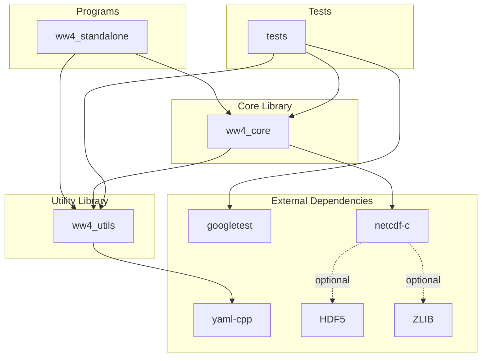
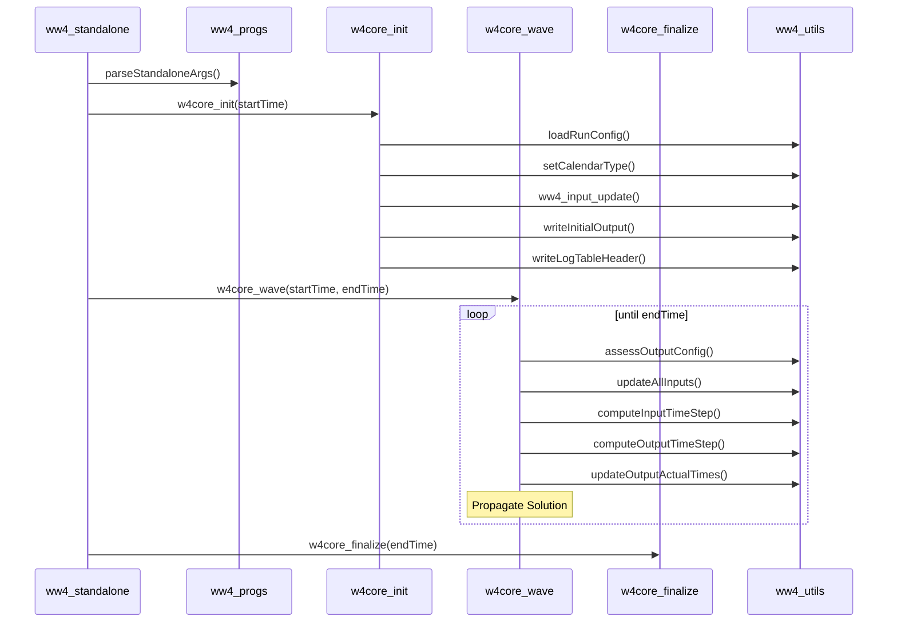
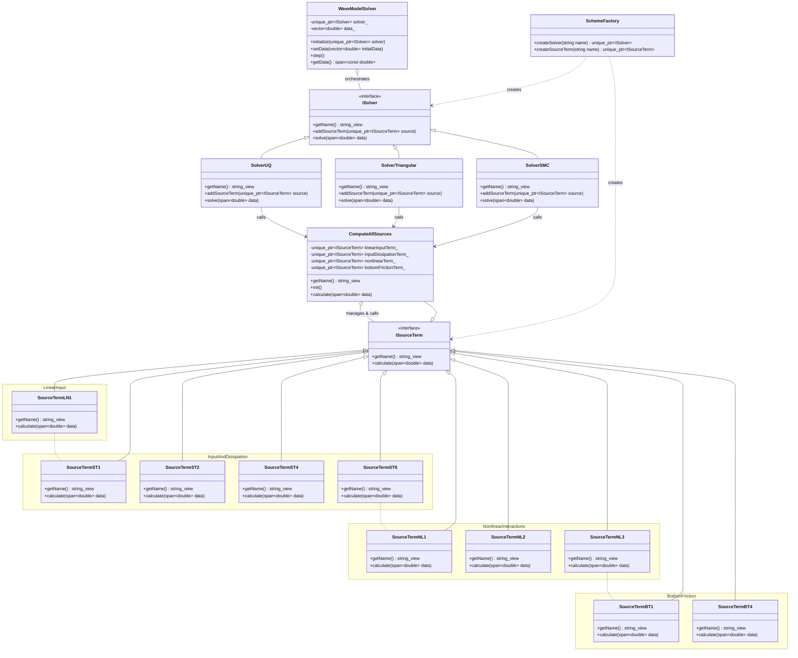
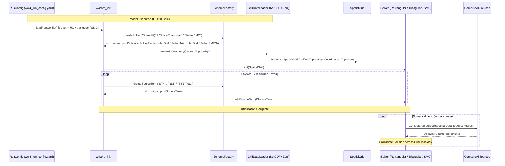

# WAVEWATCH IV Architecture

### Key Components

1.  **ISolver**: The primary integration strategy. It defines the contract for numerical solvers that combine dynamics (propagation) and physics (source terms) to advance the model state.
2.  **ISourceTerm**: The physical strategy interface for WAVEWATCH IV sub-source terms.
3.  **Source Term Implementations**:
    - **ComputeAllSources**: Unified routine called directly by each solver. Manages and executes physical `ISourceTerm` sub-source terms instantiated via `SchemeFactory`.
    - **Linear Input**: `SourceTermLN1` (LN1).
    - **Input and Dissipation**: `SourceTermST1` (ST1), `SourceTermST2` (ST2), `SourceTermST4` (ST4), and `SourceTermST6` (ST6).
    - **Nonlinear Interactions**: `SourceTermNL1` (NL1), `SourceTermNL2` (NL2), and `SourceTermNL3` (NL3).
    - **Bottom Friction**: `SourceTermBT1` (BT1) and `SourceTermBT4` (BT4).
4.  **Solvers (`SolverUQ`, `SolverTriangular`, `SolverSMC`)**: Concrete numerical solvers (Ultimate Quickest regular grid, Triangular unstructured grid, and SMC grid) that directly invoke `ComputeAllSources` during their `solve` phase.
5.  **SchemeFactory**: Responsible for instantiating individual model components (solvers and source terms).
6.  **WaveModelSolver**: The high-level orchestrator solver. It manages the simulation loop and triggers the configured solver at each time step.
This document describes the high-level architecture of WAVEWATCH IV (WW4) using a Mermaid diagram.

## Component Diagram

## Call Structure

The following diagram illustrates the sequence of function calls when running the `ww4_standalone` program.

## Description of Components

- **Programs**: Contains end-user applications. `ww4_standalone` is a simplified environment for running the wave model core.
- **Core Library (`ww4_core`)**: Implements the main wave model routines, including initialization (`w4core_init`), time stepping (`w4core_wave`), finalization (`w4core_finalize`), numerical solvers, and physical source terms located under `src/ww4_core/source_terms/`.
- **Utility Library (`ww4_utils`)**: Provides common functionality such as time management, configuration loading, logging, and standard output utilities.
- **Tests**: Contains unit tests (Level 1, prefixed with `L1_test_`) and integration tests (Level 2, prefixed with `L2_test_`) using the Google Test framework.
- **External Dependencies**:
    - `yaml-cpp`: Used for parsing YAML configuration files.
    - `googletest`: Used for unit and integration testing.
    - `netcdf-c`: Used for NetCDF and UGRID dataset reading and writing.
    - `HDF5`: Optional dependency for NetCDF-4 support in `netcdf-c`.
    - `ZLIB`: Optional compression library dependency for NetCDF-4 support in `netcdf-c`.

## Integrated Runtime Solver Selection

WW4 uses an integrated **Strategy** and **Factory** design pattern. To support complex interleaving of physics and dynamics (e.g., implicit sub-stepping), physical source terms are managed and called directly by a **Solver**.

## Integrated Ingestion & Runtime Factory Architecture

The complete runtime architecture—from NetCDF configuration loading, factory instantiation, grid data ingestion, solver initialization, and spectral physics computation—is illustrated below:

## Decoupled Grid Data Abstractions & Coupling Server Ranks

To ensure clean memory boundaries, zero allocation waste, and complete separation between full domain topology and local numerics:

* **Compute ranks hold ONLY `LocalGridPartition` data.** Compute ranks never allocate memory for the `FullGrid` dynamic state array, eliminating memory waste.
* **Internal Partition Map File Export (`writePartitionMapNetCDF`):** If no precomputed partition map file exists at model startup, the internal partitioner (`partitionGlobalGrid`) computes domain assignments and **writes the mapping to file (`partition_map.nc`)** as a side output via `writePartitionMapNetCDF` for subsequent model runs.
* **Dedicated Coupling Server Ranks:** For large operational models and real-time asynchronous coupling (e.g., online AI/ML surrogates, wave-surge-ocean coupling, or data assimilation), one or more MPI ranks are reserved specifically as **Dedicated Coupling Server Ranks**. These server ranks host the `FullGrid` topology and output buffers, receiving local field updates asynchronously via non-blocking MPI calls while compute ranks immediately proceed to the next numerical time step.

```mermaid
graph TD
    FG["FullGrid&nbsp;(Full&nbsp;Domain&nbsp;Metadata)<br/>&#8209;&nbsp;NX_full,&nbsp;NY_full&nbsp;/&nbsp;N_nodes<br/>&#8209;&nbsp;Full&nbsp;Topobathy&nbsp;&&nbsp;Coordinates"]

    subgraph PartMap ["Partitioning Lifecycle"]
        PM_CHK{"partition_map.nc<br/>exists?"}
        PM_READ["Read&nbsp;Precomputed<br/>partition_map.nc"]
        PM_GEN["Generate&nbsp;Internal&nbsp;Partition<br/><i>(solver&nbsp;specific)</i>"]
        PM_WRITE["Export partition_map.nc<br/><i>(writePartitionMapNetCDF)</i>"]

        PM_CHK -- Yes --> PM_READ
        PM_CHK -- No --> PM_GEN
        PM_GEN -. Export File .-> PM_WRITE
    end

    FG --> PM_CHK

    subgraph ComputeRanks ["Compute Ranks (Rank 0 ... Rank C&#8209;1)"]
        LP0["LocalGridPartition&nbsp;(Rank&nbsp;0)<br/><i>&#8209;&nbsp;nx_local,&nbsp;ny_local&nbsp;+&nbsp;halo</i><br/><i>&#8209;&nbsp;Local&nbsp;Topobathy&nbsp;(std::span)</i><br/><i>&#8209;&nbsp;local_to_global_map</i>"]
        LPC["LocalGridPartition&nbsp;(Rank&nbsp;C&#8209;1)<br/><i>&#8209;&nbsp;nx_local,&nbsp;ny_local&nbsp;+&nbsp;halo</i><br/><i>&#8209;&nbsp;Local&nbsp;Topobathy&nbsp;(std::span)</i><br/><i>&#8209;&nbsp;local_to_global_map</i>"]

        S0["ISolver (Rank 0)"]
        SC["ISolver&nbsp;(Rank&nbsp;C&#8209;1)"]

        LP0 --> S0
        LPC --> SC
    end

    subgraph IORanks ["Dedicated IO and coupling ranks (Rank C ... Rank C+I&#8209;1)"]
        IOR["IO&nbsp;and&nbsp;coupling&nbsp;ranks<br/><i>&#8209;&nbsp;Holds&nbsp;FullGrid&nbsp;Output&nbsp;Buffers</i><br/><i>&#8209;&nbsp;Asynchronous&nbsp;Zarr&nbsp;/&nbsp;NetCDF&nbsp;Disk&nbsp;Writes</i>"]
    end

    PM_READ --> LP0
    PM_READ --> LPC
    PM_GEN --> LP0
    PM_GEN --> LPC

    S0 -. Asynchronous Field Data .-> IOR
    SC -. Asynchronous Field Data .-> IOR
```

1. **`FullGrid` (Full Model Domain Metadata):**
   * Contains full domain dimensions ($NX_{\text{full}}, NY_{\text{full}}$ or $N_{\text{nodes}}$), coordinate vectors, and full topobathy.
   * **Memory Allocation:** Resides **strictly on Dedicated Coupling Server Ranks** (or transiently on Rank 0 during startup partition generation). **Compute ranks NEVER allocate or save `FullGrid` state arrays.**
2. **`LocalGridPartition` (Sub-Domain Compute Grid):**
   * Encapsulates the local rank's sub-mesh ($nx_{\text{local}}, ny_{\text{local}}$ or $n_{\text{local}}$), including surrounding halo/ghost cells required for stencil flux calculations across sub-domain boundaries.
   * Contains local coordinate vectors, local topobathy contiguous buffers, halo exchange communication tables, and `local_to_global_map`.
   * **Solver Independence:** `ISolver` implementations (`SolverRectangularGrid`, `SolverTriangularGrid`, `SolverSMCGrid`) and physical source terms (`ComputeAllSources`) operate *strictly* on `LocalGridPartition` views (`std::span<const double>`). Numerical solvers are completely agnostic to whether execution is single-process or multi-node MPI!