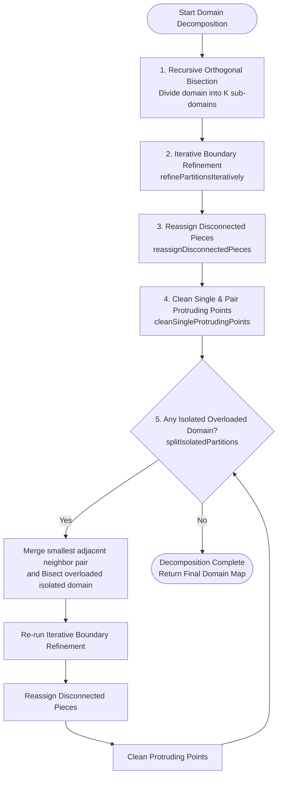

# WAVEWATCH IV Domain Decomposition Architecture

This document describes the domain decomposition algorithms, iterative refinement processes, and convergence criteria implemented for regular structured (UQ) grids in WAVEWATCH IV (`src/ww4_core/solver_UQ/UQ_domains.cpp`).

---

## 1. Domain Decomposition Pipeline Overview

Domain decomposition divides the active computational sea points of a full grid into $K$ sub-domains (where $K = \text{num\_domains}$ or $\text{num\_ranks\_compute}$) to enable balanced parallel execution.

The decomposition proceeds through four major phases:
1. **Recursive Orthogonal Bisection**: Splits rectangular bounding boxes along the longest spatial dimension into balanced halves based on active sea point counts.
2. **Iterative Boundary Refinement Sweeps**: Adjusts domain boundaries along wet interface segments to improve load balance.
3. **Disconnected Piece Reassignment & Protruding Point Cleanup**: Reassigns disconnected fragments to neighboring domains and smooths jagged 1-cell or 2-cell protruding boundary lines.
4. **Isolated Domain Split & Re-balancing**: Identifies isolated domains (lacking 4-connected neighbors) that exceed the target load, merges the smallest adjacent domain pair, and splits the isolated domain.



---

## 2. Iterative Refinement Process Flowchart

Boundary refinement iterates across the 2D grid to exchange interface cells between adjacent domains. The interface point exchange operates on contiguous segments of wet interface points (rows or columns) between overloaded domains and underloaded neighboring domains.

```mermaid
flowchart TD
    StartIter([Start Iteration Sweep<br/>iter = 0 ... max_iterations - 1]) --> LoadTarget[Compute Target Load:<br/>target = Total Sea Points / K]
    LoadTarget --> InitSwaps[Set swaps_made = 0<br/>processed_in_iter = false]
    InitSwaps --> LoopCells[Scan Grid Cells (x, y) with active wet point]

    LoopCells --> CheckOverloaded{Is domain p1 overloaded?<br/>count[p1] > floor target}
    CheckOverloaded -- No --> NextCell[Advance to next cell]
    CheckOverloaded -- Yes --> FindUnderloaded[Find candidate 4-connected neighbors p2:<br/>p2 in 1..K, p2 != p1, and count[p2] < ceil target]

    FindUnderloaded --> HasCandidates{Candidate neighbors exist?}
    HasCandidates -- No --> NextCell
    HasCandidates -- Yes --> SelectBest[Select best neighbor p2<br/>with minimum count]

    SelectBest --> ExtractSegment[Extract contiguous wet interface segment<br/>Length S along row or column]
    ExtractSegment --> CheckImbalance{Imbalance condition met?<br/>|count[p1] - S - count[p2] - S| <= |count[p1] - count[p2]|}

    CheckImbalance -- Yes --> ApplySwap[Reassign segment cells from p1 to p2<br/>count[p1] -= S, count[p2] += S<br/>swaps_made += S<br/>Mark segment processed]
    CheckImbalance -- No --> NextCell

    ApplySwap --> NextCell
    NextCell --> CellsFinished{All grid cells scanned?}
    CellsFinished -- No --> LoopCells
    CellsFinished -- Yes --> CleanPoints[Clean 1-point and 2-point protruding boundaries<br/>swaps_made += cleaned]

    CleanPoints --> DisconnSweep[Reassign disconnected pieces to smallest neighbor<br/>swaps_made += reassigned]
    DisconnSweep --> CheckSwaps{swaps_made == 0 or<br/>iter == max_iterations - 1?}

    CheckSwaps -- Yes --> Converged([Convergence Reached<br/>Exit Refinement Loop])
    CheckSwaps -- No --> StartIter
```

---

## 3. Convergence Criteria and Swap Conditions

The iterative boundary refinement algorithm (`refinePartitionsIteratively`) uses the following exact mathematical and logical convergence criteria:

### 3.1. Target Load Definition
Given total active sea points $N_{\text{sea}}$ and total domains $K$:
$$\bar{N} = \frac{N_{\text{sea}}}{K}$$
- A domain $p_1$ is **overloaded** if:
  $$\text{count}[p_1] > \lfloor \bar{N} \rfloor$$
- A neighboring domain $p_2$ is **underloaded** if:
  $$\text{count}[p_2] < \lceil \bar{N} \rceil$$

### 3.2. Candidate Neighbor Selection
Among all 4-connected adjacent domains bordering cell $(x, y)$ that satisfy the underloaded criterion, the candidate $p_2$ with the **smallest active sea count** $\text{count}[p_2]$ is selected. If tied, the lower domain ID is chosen.

### 3.3. Interface Segment Definition
To avoid jagged checkerboard patterns, exchanges occur per contiguous segment of length $S \ge 1$ of adjacent wet boundary points:
- For horizontal interfaces (neighbor to South or North), the contiguous segment along row $y$ bordering $p_2$ is gathered (wrapping longitudinally across the 360° closure line when `is_global` is true).
- For vertical interfaces (neighbor to West or East), the contiguous segment along column $x$ bordering $p_2$ is gathered.

### 3.4. Strict Imbalance Reduction Criterion
The candidate segment of size $S$ is transferred from $p_1$ to $p_2$ **if and only if** the transfer does not increase the load difference between $p_1$ and $p_2$:
$$\Delta_{\text{after}} \le \Delta_{\text{before}}$$
where:
$$\Delta_{\text{before}} = |\text{count}[p_1] - \text{count}[p_2]|$$
$$\Delta_{\text{after}} = |(\text{count}[p_1] - S) - (\text{count}[p_2] + S)|$$

If $\Delta_{\text{after}} > \Delta_{\text{before}}$, the exchange is rejected to prevent oscillation.

### 3.5. Loop Termination (Convergence)
The refinement loop terminates when:
1. **Zero swaps executed**: A full pass over the 2D grid produces $\text{swaps\_made} == 0$ (including cell segment swaps, protruding point cleanups, and disconnected piece reassignments).
2. **Iteration limit reached**: The counter reaches `max_iterations` (default: 100 in `solver_UQ_init.cpp`).

---

## 4. Architectural Analysis: Why One Domain Can Remain Significantly Larger

In empirical simulations, it is occasionally observed that one domain ends up significantly larger than the others, leading to computational imbalance and suboptimal scaling. The primary architectural causes identified in `UQ_domains.cpp` are:

1. **Discrete Segment Size Quantization ($S > 1$)**:
   Because boundary transfers operate on contiguous multi-point segments of length $S$ rather than individual points, if an overloaded domain borders an underloaded domain along a long uninterrupted coast or interface (e.g. $S = 15$ cells), moving all $S$ points would overshoot the balance:
   $$|(\text{count}[p_1] - S) - (\text{count}[p_2] + S)| > |\text{count}[p_1] - \text{count}[p_2]|$$
   As a result, the swap is rejected. Individual point slivers are prevented from moving to avoid creating jagged boundary artifacts, locking the larger domain in place.

2. **Topological / Geography Bottlenecks**:
   In complex coastal or archipelagic geometries (narrow straits, inland seas, semi-enclosed basins), an overloaded domain may only border one or two domains across very narrow interfaces. If the bordering domains are already at or near their target capacity ($\text{count}[p_2] \ge \lceil \bar{N} \rceil$), they cannot accept additional cells.

3. **Isolated Water Bodies & Semi-Enclosed Seas**:
   When water bodies are completely separated by land barriers, they have no 4-connected sea neighbors (`partition_neighbors[p].empty()`). While `splitIsolatedPartitions` attempts to merge the smallest external pair to bisect an isolated overloaded domain, if the domain is not strictly isolated (e.g. connected by a 1-cell strait) or if no valid external merge pair exists, the isolated domain cannot offload points to the rest of the ocean basin.

4. **Bisection Remainder Asymmetry**:
   During the initial recursive bisection, integer division splits $K$ into $p_1 = \lfloor K / 2 \rfloor$ and $p_2 = K - p_1$. On irregular landmasks, bounding box cuts can place a disproportionate fraction of wet points into a sub-box where subsequent bisections are constrained by aspect ratio thresholds, leaving one sub-domain with an initial excess that boundary sweeps cannot fully smooth across distant domain boundaries.
